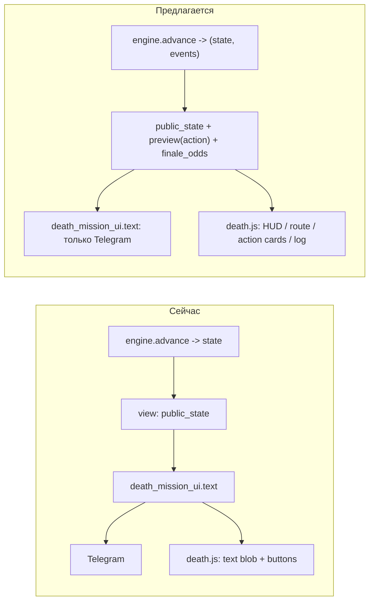

# Ревью Смертельной операции: геймплей, фронтенд, архитектура

## Что смотрел

- Движок [spy_game/death_mission.py](spy_game/death_mission.py), репозиторий [spy_game/death_mission_repository.py](spy_game/death_mission_repository.py), копирайт и Telegram-фолбэк [spy_game/death_mission_ui.py](spy_game/death_mission_ui.py), HTML5 [spy_game/webapp_static/death.js](spy_game/webapp_static/death.js) + [game.html](spy_game/webapp_static/game.html) + [game.css](spy_game/webapp_static/game.css), презентер `death_payload` в [spy_game/webapp_presenters.py](spy_game/webapp_presenters.py), симулятор [spy_game/death_mission_simulation.py](spy_game/death_mission_simulation.py), тесты, runbook и гайд игрока.
- Дополнительно прогнал симулятор (4000 забегов на политику) и посчитал точную DP-вероятность пройти финал из любого состояния входа. Ниже цифры из этих прогонов.

## Сильные стороны (не трогать)

- Персистентность сделана добротно: escrow + ledger, idempotency по `operation_id`, revision, детерминированный `roll(seed, key)`, outbox с редактированием сообщения, `validate()` с техническим возвратом. 27 тестов покрывают гонки, таймауты, откаты.
- Движок чистый (нет часов и балансов), seed только в репозитории, публичное состояние не течёт.

## Находки: геймплей

**1. Все смерти происходят на финале, узлы 1–5 практически безопасны.**
Прогон: careful — 557 смертей, все на боссе; aggressive — 3019, все на боссе; random — 2986, из них 14 на узлах. Пять узлов не создают риска, они только копят ресурсы к трём одинаковым броскам в конце. Игрок ощущает это как «долго жму кнопки, потом лотерея».

**2. Финал при идеальной подготовке остаётся ~50/50.**
DP по правилам движка (оптимальные решения, вход с тревогой 0):
- Бронепоезд, без модулей: hp6/intel4 = 49%, hp6/intel2 = 45%, hp5/intel4 = 37%, hp4/intel2 = 17%.
- Штаб, без модулей: hp6/intel6 = 47%, hp5/любой intel = 25%, hp4 = 9–17%.
- С Бронепластинами: Бронепоезд hp6 = 78%, Штаб hp6 = 60%. Это единственный модуль, который реально меняет исход.
- Скрытый обрыв: при hp 6 три подготовленных прохода стоят 3 hp, одно осложнение (3 урона) убивает. Игрок этого не видит.

**3. Часть контента не работает или доминируется.**
- Полевой медик и Поддельный пропуск дают ~0% к финалу (медик не лечит между фазами, тревога на боссе почти не доходит до 6). Аварийный канал полезен только первым модулем. Глушитель даёт +2–7 п.п.
- «Тихий вход» (5/3) на финале хуже «Баланса» (6/2): 37% против 45% на Бронепоезде. Разблокируемая тактика — даунгрейд.
- «Прорываться» на финале (60–90% риск, 4 урона) почти всегда хуже подготовленного прохода; это не выбор, а штраф за нехватку intel.
- Три фазы финала — одни и те же две кнопки; в гайде на это уходит целый раздел «почему кнопки повторяются», что само по себе симптом.

**4. Игрок не видит влияния решений.**
- Лог хранит только `"Название — выполнено/осложнение"` без дельт ресурсов.
- `lethal` считается только по фиксированной цене hp; действие с 60% риском умереть от осложнения флага не получает, а «Пройти через заграждения» при hp 1 — получает. Непоследовательно.
- Нет ни одной подсказки «что будет, если…»: ни двух веток (без осложнения / с осложнением), ни шанса пережить финал из текущего состояния, ни сравнения «эвакуировать X сейчас» против «~Y% на 2X + бонус».
- Модули предлагаются без контекста ценности («Бронепластины: 45% → 63%»).

## Находки: фронтенд

- HTML5 показывает **Telegram-текст**: `death_payload` добавляет `text = mission_text(payload)`, а `death.js` рендерит его одним `
` и ниже голые кнопки. Нет HUD, карты маршрута, карточек действий. Действия перечислены дважды (в тексте и в кнопках).
- `render()` делает `root.replaceChildren()` при каждом действии, при `busy` и при каждом изменении по опросу (2 с): экран мигает, во время запроса кнопки исчезают, читать нечего.
- Подтверждение смертельного действия через `window.confirm` — в Telegram WebView `alert/confirm/prompt` не поддерживаются на части клиентов (нужен `Telegram.WebApp.showConfirm` или своё окно). Вероятный дефект: действие вообще не отправляется.
- Выбор тактики и бонуса — нативные `<select>` без описаний (hp/intel), закрытые тактики не показаны и не объясняют условие открытия.
- Удержание 3 с: нет индикатора прогресса, `pointerleave` сбрасывает при малейшем сдвиге пальца, нет `touch-action: none`/pointer capture.
- Терминальный экран — просто текст; готовый `#result` из `game.html` не используется.
- Telegram-клавиатура на входе: до 7 кнопок вида «Миссия · Баланс · Tier 3 ×2» (все комбинации тактика × бонус). Строки действий вида `разведданные −1; состояние −1; осложнение 35%: урон 3, тревога +1` тяжело сканировать.

## Находки: архитектура

- В [death_mission.py](spy_game/death_mission.py) контент (таблицы комнат, действий, модулей, боссов) смешан с правилами в `actions()` и `advance()`. `advance()` — монолит с неявным порядком «цена → бросок → эффекты → модули → облава → clamp → смерть → медик → переход». Он не возвращает событий, поэтому ни один UI не может показать, что именно произошло.
- `VERSION = "roguelite_v1"` зашита в `roll()` и `validate()`. Любая правка чисел ломает `validate()` для открытых забегов и приводит к `cancelled_refunded` при рестарте. Для ребаланса нужен реестр версий правил, как и обещано в runbook («обработчик предыдущей версии сохраняется»).
- Презентер отдаёт HTML5 Telegram-копирайт (`text`) вместо структурированных данных. Связь `death_mission_ui` → веб нужно разорвать.
- `death.js`: один замыкающий скрипт, state → полный ререндер. Тесты ([tests/test_death_mission_ui.js](tests/test_death_mission_ui.js)) проверяют только протокол (arm/commit/retry), не отображение.
- Симулятор не имеет «сильной» политики, которую требует экономический гейт из плана; смерти по узлам, распределение состояния на входе в финал и частота осложнений не отчитываются.
- Мелочи: `pending_results` берёт `datetime.now()` вместо переданного `now`; `view()` делает 2 запроса по достижениям на каждый рендер, включая outbox.

## Предложения по приоритету

### Этап 1. Показать влияние решений (сервер + оба UI, без изменения баланса)

- В движке добавить `preview(state, action_id)`: детерминированно прогнать обе ветки (`failed=False/True`) и вернуть состояние после, флаг облавы, сработавшие модули. Отдавать в `actions[].preview`. Пересчитать `lethal` как `may_die` (любая ветка даёт hp 0) и `certain_death`.
- Добавить `finale_odds(state)`: DP по финалу (то, что я считал вручную) — вероятность пройти три фазы при оптимальной игре из текущих ресурсов и модулей. Используются только публичные данные, утечки нет. Показывать как «Шанс пройти финал при текущих ресурсах: N%» и дельту рядом с каждым действием и модулем в предложении.
- `advance()` возвращает `(state, events)`; события хранить в `state["log"]` структурировано (тип, дельты hp/intel/alarm, risk, failed, raid, absorbed). Строковый лог для старых забегов оставить читаемым через адаптер.
- Экран эвакуации: «Сейчас вернёте X гарантированно» против «Продолжение: ~N% на 2X + бонус, иначе 0 / половина до таймаута».
- Telegram-фолбэк: лог с дельтами, многострочные описания действий, двухшаговый выбор режим → тактика → бонус.

### Этап 2. Переработать отрисовку HTML5

- Заменить текстовый блок структурированными экранами: HUD с тремя шкалами (6 сегментов, маркер облавы на 6, предупреждение на 5), полоса маршрута из 6 узлов (текущий, чекпоинт, слоты модулей, объект финала), карточка комнаты с карточками действий (цена / гарантированный эффект / чип риска / что при осложнении / бейдж опасности), карточки модулей с дельтой шанса, результат через существующий `#result`.
- Инкрементальный рендер: постоянный DOM на экран, обновление значений, блокировка кнопок при `busy` без очистки, анимация изменения чисел после ответа.
- Вход: сегментированный выбор тактики с hp/intel и заблокированными вариантами с условием открытия; бонус двумя карточками; ставка списком агентов в стиле `app.js`.
- Удержание: кольцо прогресса, `setPointerCapture`, `touch-action: none`; подтверждения только внутри страницы (`Telegram.WebApp.showConfirm` при наличии, иначе своя панель).
- Убрать `text` из `death_payload`; разделить `death.js` на модель, view-model и рендереры экранов; расширить тестовый DOM-харнесс проверками отображения (HUD, карточки, лог).

### Этап 3. Ребаланс контента (только через симулятор и DP)

- Ввести реестр версий правил (`roguelite_v1` остаётся для открытых забегов, новые события получают `roguelite_v2`); контент вынести в таблицы отдельно от правил.
- Кандидаты правок, каждый проверяется симулятором с добавленной DP-оптимальной «сильной» политикой и отчётом по смертям на узлах и состоянию на входе в финал:
  - сместить часть риска с финала на узлы 3–5 (иначе маршрут не ощущается);
  - сделать три фазы финала разными по действиям и стоимости, «Прорываться» — реальной альтернативой (ниже риск/урон, выше тревога), а не штрафом;
  - медик лечит между фазами финала; пропуск также снижает урон облавы; «Тихий вход» получает −5 п.п. к риску, чтобы не быть даунгрейдом;
  - при показе дельт ценность слабых модулей станет очевидной игрокам — это дополнительный аргумент чинить их до включения этапа 1 в beta.
- Экономический гейт из плана (ожидаемый возврат сильной политики) считать до включения; сейчас он не выполняется, т.к. «сильной» политики в симуляторе нет.

## Что не входит и риски

- Не трогаю escrow, ledger, outbox и порядок транзакций — они корректны.
- Этап 1 повышает информированность игроков, а значит фактический винрейт; после него экономику нужно пересмотреть через симулятор до beta, а не после.
- Любое изменение чисел движка без реестра версий приведёт к техническому возврату всех открытых забегов при рестарте.

## Доработка после независимого ревью, 2026-09-21

Реализация v2 из `152ee01` сохранена для существующих preview и забегов.
Новые preview используют `roguelite_v3`; редактирование чисел уже выпущенных
версий заменено отдельной записью реестра.

- Исправлены приоритет CSS при скрытии миссии, откат к устаревшей ревизии после
  задержавшегося polling и подтверждения действий из прошлой ревизии.
- Условная вероятность финала больше не названа шансом всего маршрута на
  экране эвакуации. Для модулей объяснена ограниченность этой метрики.
- Новый offline `RoutePolicy` оптимизирует полную выплату по всему маршруту,
  учитывая будущие предложения и эвакуацию без доступа к seed/скрытой карте.
  Прежняя finale-greedy политика сохранена под названием `informed`.
- С разрешения пользователя изменены награды v3: сеть ×2; бонус Tier 3 ×1 или
  Tier 4 ×1 доступен при ставке пяти агентов нужного тира или выше. С любой
  ненулевой сетью можно играть без бонуса. All-in и награды v1/v2 сохранены.
- Порог риска на узлах 3/4/5 — 10/30/40%, урон осложнения — 3/4/5; урон фаз
  финала — 3/3/4. «Прорываться» имеет базовый риск 45%, расходуя тревогу вместо
  разведданных. Конкретные числа вынесены в таблицы v3.
- Settlement и симулятор используют одну функцию выплат. Отчёт включает
  точные составы ставок, бонусы, округление по типам, Tier и интервалы.
- На независимом наборе `validation-v3-20260921` выполнено 360 000 забегов:
  гейт полной выплаты ≤1,15 пройден, максимальная DP-граница 1,130245.
  В контрольной сильной политике 25,14% смертей происходят до финала.
- 403 Python-теста, 12 JS-тестов и реальный Chrome (300–760 px) прошли.
  Эталонные траектории v1/v2 совпадают с коммитом 152ee01.

Отчёт: `docs/ideas/spy-game-death-mission-balance-v3.json`.
Актуальные правила и воспроизведение: `docs/runbooks/spy-game-death-mission.md`
и `docs/spy-game-death-mission-player-guide.md`. Это локальная проверка;
публикация, перезапуск сервиса и Telegram smoke в этот этап не входят.
