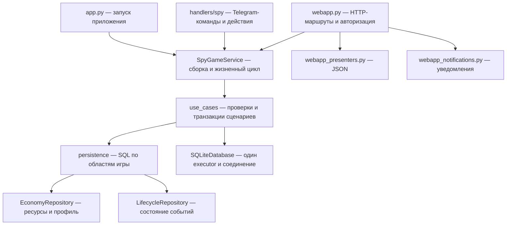

# Модули Spy Clicker после декомпозиции

Дата: 7 сентября 2026 года.

Рефакторинг охватывает четыре наиболее разросшихся модуля Spy Clicker:
SQL-хранилище, сервис, Telegram-обработчики и HTTP-адаптер. Правила игры,
SQLite-схема, callback-данные, HTTP-маршруты и форматы ответов сохранены.

## Границы ответственности



`SpyGameService` создаёт один `SQLiteDatabase`, один набор репозиториев и
компоненты сценариев. Telegram и HTTP используют этот же экземпляр сервиса.
В `use_cases/base.py` общий контекст передаёт зависимости компонентам;
базовый класс содержит доступ к ним, проверку доступности чата и хеширование
токенов. В нём нет реализаций отдельных игровых сценариев.

## Где искать код

| Задача | Модуль |
| --- | --- |
| Запуск, остановка, периодический tick, управление чатами | `spy_game/service.py` |
| HTML5-запуск, действия и чтение игровых сессий | `spy_game/use_cases/html5.py` |
| Death Mission, callback-владение и ревизии | `spy_game/use_cases/missions.py` |
| Ставки дуэлей | `spy_game/use_cases/duels.py` |
| Inline-сценарии событий | `spy_game/use_cases/events.py` |
| Контакты, престиж, агентство, профиль и экипировка | `spy_game/use_cases/economy.py` |
| Сборка SQL-компонентов | `spy_game/repositories.py` |
| Пользователь, агенты, предметы, списания и награды | `spy_game/persistence/economy.py` |
| Закрытие, восстановление и публикация событий, сюжет | `spy_game/persistence/lifecycle.py` |
| Активность, триггеры, создание событий | `spy_game/persistence/scheduling.py` |
| SQL конкретного режима | `spy_game/persistence/{recruitment,dead_drop,intercept,find_mole,death_operation,cooperative,chase}.py` |
| Обмены с NPC и постоянными контактами | `spy_game/persistence/contacts.py` |
| Репутация и создание агентства | `spy_game/persistence/progression.py` |
| Атомарное состояние Death Mission | `spy_game/death_mission_repository.py` |
| Ставки и расчёт дуэлей | `spy_game/duels.py` |
| Стабильные импорты Telegram-обработчиков | `handlers/spy_game.py` |
| Выбор обработчика callback | `handlers/spy/callbacks.py` |
| Действия меню, экономики и игровых режимов | `handlers/spy/callback_*.py` |
| Тексты, карточки и клавиатуры | `handlers/spy/{menu_views,event_views,formatting}.py` |
| Доставка сообщений с rich/plain fallback | `handlers/spy/transport.py` |
| Публикация событий и редактирование прогресса набора | `handlers/spy/publication.py` |
| `/spy`, `/spy_admin`, tick и HTML5-запуск | `handlers/spy/{menu,admin,jobs,html5}.py` |
| Telegram-интерфейс Death Mission | `handlers/spy/missions.py` |
| HTTP-маршруты, авторизация и static assets | `spy_game/webapp.py` |
| HTTP-настройки и ограничитель запросов | `spy_game/webapp_{settings,support}.py` |
| Формирование JSON и уведомлений о победе | `spy_game/webapp_{presenters,notifications}.py` |

## Транзакции и зависимости

Сценарий открывает `database.transaction(..., immediate=True)` и передаёт
полученное соединение репозиторию. Репозиторий режима вызывает общую экономику
и жизненный цикл с тем же соединением. Проверка ресурсов, списание, награда,
закрытие события и запись истории остаются одной атомарной операцией.
Репозитории не открывают соединения и не выполняют самостоятельный commit.

Например, `ContactsRepository` получает `EconomyRepository` и
`LifecycleRepository` явно в конструкторе. Он не обращается обратно к общему
`SpyRepository`. `DeathMissionRepository` также получает только компонент
экономики, который ему необходим. Общие SQL-операции экономики имеют явные
имена: `ensure_user`, `has_costs`, `spend_costs`, `add_reward`, `add_drop_reward`.

Внешний код продолжает вызывать методы **экземпляров** `SpyGameService` и
`SpyRepository`. Перенесённые методы явно привязаны к компонентам в
конструкторах; сигнатуры bound-методов сохранены. Подмена методов для теста
выполняется на экземпляре или компоненте, а не на прежнем классе монолита.
Telegram-функции экспортируются из прежнего `handlers.spy_game`.
Подмена `send_rich_message` теперь находится в `handlers.spy.transport`.

## Проверка

До переноса проходил 221 тест. После переноса проходят те же сценарии и
четыре новых архитектурных проверки — всего 225 тестов. Существующие проверки
включают конкурентные выплаты, повторные действия, перезапуск, откат SQL при
ошибке, HTTP-авторизацию и Telegram fallback.

`tests/test_spy_architecture.py` проверяет направление импортов, отсутствие
циклов между модулями реализации и сохранение управления транзакциями за
сервисным слоем. Дополнительно при рефакторинге сравнены AST перенесённых
методов и всех 16 извлечённых ветвей callback; изменения ограничены
направлением обращений к зависимостям.

```bash
PYENV_VERSION=3.12.4 pytest -q
node --test tests/test_death_mission_ui.js
git diff --check
```

Миграции и изменения запуска не требуются. Локальные проверки не заменяют
проверку Telegram и публичного HTTP на сервере; развёртывание в рамках этого
рефакторинга не выполнялось.

## Оставшиеся области

`handlers/games.py`, `handlers/duel.py`, `handlers/ai.py`, а также каталоги
настроек и моделей остаются отдельными кандидатами на последующую
декомпозицию. Их поведение и структура в этой поставке не менялись.
Замечания функционального аудита от 5 сентября не считаются исправленными
этим переносом: для них нужны самостоятельные изменения с регрессионными
проверками.
