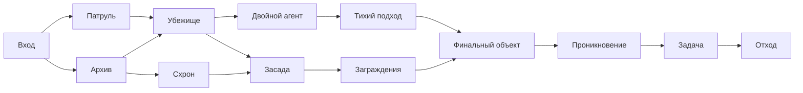

# Смертельная операция: ревью и переход к визуальному roguelite

Дата: 2026-09-22. Проверены текущие исходники, runbook, движок, SQLite lifecycle,
Telegram/HTML5, стандартные обмены и локальные тесты. Это ревью и предложение
следующей версии; рабочие правила и код игры в рамках исследования не изменялись.

**После ревью:** по запросу «давай сделаем» реализована новая версия `roguelite_v4`.
По уточнению пользователя сохранена ставка всей доступной сетью. Исправления,
специалисты, схема Архива, визуальная карта и постоянная тренировка описаны в
[актуальном runbook](runbooks/spy-game-death-mission.md#новые-операции-roguelite_v4).
Исследовательские предложения и эксперимент ниже оставлены как история;
они не являются текущими игровыми правилами.

Основа пригодна для развития: сервер уже хранит забег, фиксирует версию правил,
резервирует ставку, восстанавливает ход и защищает выплату от повторного запроса.
Главный конфликт дизайна — обучение через повторные попытки при ставке всей сети
и награде, пропорциональной этой сети. Одной визуализации и снижения процентов
недостаточно: нужны понятные последствия, осмысленные сборки и приемлемая цена ошибки.

## 1. Найденные проблемы

### P1. Сохранённый вход обходит общее отключение игры и allowlist

Место: [use_cases/missions.py](../spy_game/use_cases/missions.py#L37),
[мутации](../spy_game/use_cases/missions.py#L73),
[commit](../spy_game/death_mission_repository.py#L329).

`chat_is_available()` вызывается при новом входе, но отсутствует в чтении уже
открытого забега, мутациях и Telegram callback. `refresh()` проверяет статус
события и сроки, но не настройки доступности. HTTP вызывает эти же методы.

Локально воспроизведено на временной SQLite:

1. Создать preview с шестью осведомителями.
2. Перезапустить сервис с общим `settings.enabled=False` либо с удалённым
   из allowlist чатом.
3. Выполнить `arm`, затем `commit` с сохранённым токеном.
4. При `chat_is_available(chat)==False` получается `status=in_run`, доступный
   баланс уменьшается с 6 до 0.

Нужно проверять доступность внутри транзакции перед новыми резервированиями,
одинаково для HTTP и Telegram. Для уже зарезервированных миссий явно определить
общий путь административного возврата. Отдельный `death_mission_enabled=False`
не смешивать с общим выключателем: по текущему договору он останавливает только
создание новых событий, а открытые забеги должны обслуживаться.

Регрессии: preview → общее отключение → arm/commit; armed → удаление из allowlist
→ commit; те же случаи через callback; один возврат при отмене активного забега.

### P2. Поздний «Аварийный канал» занимает слот без эффекта

Место: [пул модулей](../spy_game/death_mission.py#L328),
[проверка эвакуации](../spy_game/death_mission.py#L124).

Модуль только переносит открытие эвакуации с пройденного узла 3 на узел 2.
Он предлагается и после узла 3, когда эвакуация уже открыта навсегда.
Второй слот ограничен, поэтому новичок может потратить его впустую.

Воспроизведение: seed `review-escape:0`, тактика `balanced`, политика `careful`.
На второй выдаче: `node=3`, `checkpoint=True`, предложения
`escape/passport/medic`. Выбор `escape` оставляет доступность эвакуации прежней
и не имеет другого действия.

Для новой версии исключать полностью бесполезные предложения. Альтернатива —
добавить позднее применение, но изменение возврата агентов потребует отдельного
баланса. Фильтрация — более простой первый шаг. Она тоже меняет распределение
предложений: необходимо обновить `RoutePolicy` и симулятор.

### P2. Подсказки противоречат фактическим эффектам модулей

Места: [HTML5, подсказка облавы](../spy_game/webapp_static/death.js#L425),
[карточка действия](../spy_game/webapp_static/death.js#L519),
[Telegram](../spy_game/death_mission_ui.py#L89).

Карточка всегда пишет, что осложнение добавит тревогу +1, даже с Глушителем.
HUD всегда обещает облаву с уроном 2 и тревогой 4, даже когда свежий Поддельный
пропуск отменит её и установит тревогу 3, а использованный уменьшит урон до 1.
Защита может дополнительно изменить урон. При этом итоговые ветки `preview`
вычислены движком правильно: ошибка в кратких подсказках, а не в settlement.

Пример: `patrol/rush`, тревога 5, модули `silencer/passport`. Обе ветки получают
тревогу 3 с отметкой `passport=True`, `raid=False`; общая подсказка обещает
другое. Для игрока, который ориентируется на значки, это существенное расхождение.

Выводить фактические модификаторы с сервера и использовать одну модель для
краткой карточки и подробных веток. Показывать оставшиеся заряды защиты.

### P2 / решение по механике. Щит «Штурма» может сгореть, поглотив 0

Место: [_damage](../spy_game/death_mission.py#L178).

Если Бронепластины полностью поглотили урон 1, код всё равно снимает
`assault_shield`. Воспроизведено: `assault + armor`, действие `patrol/crawl`:
состояние 6 → 6, суммарно поглощено 1, щит стал `False`. Одноразовая защита
не принесла дополнительной пользы.

Поведение подтверждено; считать ли его задуманным суммированием защиты на первом
попадании — вопрос правил. Для понятных сборок рекомендую сохранять щит, если
после брони урона не осталось. Закрепить приоритет поглощения явным тестом.

Изменения механики делать в новой версии правил, сохраняя воспроизводимость
v1/v2/v3. Проверки доступа и исправления отображения можно делать отдельно.

## 2. Почему сейчас трудно и что даёт облегчение

В v3 максимальное состояние — 6. Узлы 4–5 имеют минимальный риск 30/40%,
урон осложнения 4/5 и удорожание платных проходов. Безопасной дорогой альтернативы
там нет. Единственное гарантированное Убежище находится на узле 2. Финал — ещё
три проверки с уроном 3/3/4. В результате подготовка уменьшает опасность, но
поздний бросок легко перечёркивает весь маршрут.

В существующем [отчёте v3](ideas/spy-game-death-mission-balance-v3.json)
на 10 000 seed для стартового «Баланса»: `careful` побеждает в 22,4%,
`informed` — в 31,8%, `strong` — в 35,59% случаев.
Последняя политика оптимизирует ожидаемую выплату, включая эвакуацию;
это не максимум вероятности победы и не модель поведения живого игрока.

Дополнительно выполнен парный эксперимент: по 2 000 одинаковых seed на вариант
и политику, только «Баланс». Менялись таблицы в отдельном процессе; версия для
хеширования оставалась v3, поэтому карта, предложения и броски сопоставимы.
Финал, награда, тактики и модули оставались прежними.

| Вариант | Урон на узлах 1–5 | Минимальный риск на узлах 3–5 | Победы careful | Победы informed |
|---|---|---|---:|---:|
| Текущая v3 | 2/2/3/4/5 | 10/30/40% | 22,15% | 31,65% |
| Мягче только урон | 2/2/2/3/3 | 10/30/40% | 32,05% | 42,95% |
| Мягче урон и риск | 2/2/2/3/3 | 5/15/20% | 40,45% | 51,45% |

Это предварительные оценки эвристик, без бонуса в целевой функции.
Для informed доля эвакуаций составила соответственно 23,85%, 24,00%, 17,00%.
Ожидаемый возврат самой ставки — 0,75225 / 0,979 / 1,114 в нормированной модели
с возвратом ровно 0,5 при эвакуации; округление конкретных составов здесь
не исследовалось.

**У облегчения есть измеримая цена для экономики.** Дополнительный точный
расчёт `RoutePolicy` для «Баланса» и «Штурма», обоих финалов и существующей
верхней модели выплат `2,2 за победу / 0,5 за эвакуацию` дал:

| Вариант | Максимум среди проверенных комбинаций | Нынешний предел |
|---|---:|---:|
| Текущая v3 | 1,130244 | 1,15 |
| Мягче только урон | 1,364770 | 1,15 |
| Мягче урон и риск | 1,498276 | 1,15 |

Во всех трёх случаях указанный максимум — «Штурм / Бронепоезд».
Это точные значения данной модели, а не измеренная инфляция в production.
Два облегчённых варианта не проходят существующий консервативный гейт;
полный экономический прогон по всем составам не выполнялся.

[Машиночитаемые результаты эксперимента](ideas/spy-game-death-mission-easing-experiment-2026-09-22.json).

Предлагаю два масштаба изменений:

1. **Ближайшая версия:** снизить разовый урон до 2/2/2/3/3, исправить бесполезные
   предложения и объяснение защиты. Затем подобрать выплату и повторить полный
   экономический расчёт. Сохранить вероятность неприятности, уменьшив вероятность
   мгновенного обнуления забега.
2. **Квестовый режим:** выбирать небольшой отряд, а награду задавать сложностью
   контракта. Удвоение всей сети оставить условием отдельного all-in/испытания.
   Ограничение отряда уменьшает абсолютный риск, но само по себе не исправляет
   отношение выплаты к ставке: размер награды всё равно нужно пересчитать.

Бесплатная тренировочная миссия без экономических наград даст возможность
разобраться с интерфейсом. Её прогресс учитывать отдельно, чтобы она не стала
обходом условий экономических открытий. Целевую частоту побед для обычного
контракта можно начать проверять в диапазоне 50–60% у освоившего правила игрока;
это продуктовая гипотеза для beta, не гарантия этих чисел при указанных настройках.

## 3. Саботажник и Агент-призрак: что уже делают

Проверены обращения к обоим идентификаторам, стандартные рецепты и общая
обработка типов/тиров. Настройки реального сервера не исследовались.

| Агент | Получение | Расходование в стандартных рецептах | Польза сейчас |
|---|---|---|---|
| Саботажник, Tier 3 | Обмен связного на случайный Tier 3, Вербовщик, награды погони и Смертельной операции | Нет | Коллекция, число редких агентов в рейтинге, ставка/удвоение; входит в порог бонуса Tier 3 |
| Агент-призрак, Tier 5 | Контрразведка: Спящий агент ×1 + Код доступа ×1 | Нет | Отдельное достижение за получение, коллекция, рейтинг, ставка/удвоение; входит в пороги бонусов Tier 3 и Tier 4 |

Основания: [типы и рецепты](../spy_game/settings.py#L26),
[рецепт призрака](../spy_game/settings.py#L302),
[погоня](../spy_game/chase_rules.py#L18),
[рейтинг](../spy_game/persistence/economy.py#L129),
[достижения](../spy_game/persistence/achievements.py#L70),
[бонусы миссии](../spy_game/death_mission_rewards.py#L6).

Полностью бесполезными их назвать нельзя. Но собственной игровой роли у обоих
нет: `initial(seed, tactic, version)` вообще не получает состав отряда.
Их специализации хорошо подходят для добавления в этот режим.

Предлагаемая первая механика — по одной активируемой способности на забег:

| Специалист | Где применяется | Эффект для первого теста | Как выглядит для игрока |
|---|---|---|---|
| 💣 Саботажник | Прорыв из засады; «Прорываться» в фазах проникновения/задачи | Снизить риск осложнения выбранного действия на 10 п.п. | На сцене заряды у заграждения; кнопка «Подорвать проход · 1 заряд», затем риск 45% → 35% |
| 👻 Призрак | Подготовленный отход или коллектор в последней фазе | Снизить риск осложнения выбранного действия на 15 п.п. | На карте подсвечивается тихий выход; кнопка «Стереть след · 1 заряд», например 40% → 25% |

Точные числа — начальные параметры для симуляции. Речь о процентных пунктах
вероятности осложнения, а не о прибавке к вероятности победить весь забег.
Последняя фаза финала и досрочная эвакуация — разные действия: способность
Призрака в первом варианте не увеличивает возврат ставки при эвакуации.

Ограничения и поведение:

- Специалист должен входить в реально зарезервированный состав. Проверка — по
  снимку ставки при commit, а не по текущему инвентарю, который может измениться.
- Один агент включает способность; десять агентов не дают десятикратный бонус.
  Максимум два слота поддержки, по одному каждого типа.
- Заряд расходуется атомарно с соответствующим действием. Повтор HTTP-запроса
  не расходует его второй раз. Покупка агента после старта не добавляет способность.
- Применение способности не списывает агента ещё раз: его возврат определяется
  исходом миссии, как и для остального отряда.
- Показать «базовый риск → модификатор специалиста → итоговый риск» до выбора.
  После использования портрет остаётся, но заряд явно отмечен израсходованным.
- Снижение применяется после обычных надбавок/нижнего порога и ограничивается
  снизу нулём. Эту формулу зафиксировать в правилах и учитывать в обеих ветках,
  прогнозе финала и политике всего маршрута.

Позднее способности можно связывать с головоломками: Саботажник убирает один
опасный узел схемы, Призрак раскрывает дополнительный безопасный коридор.
Не следует сразу одновременно выдавать процент, уменьшать урон и убирать тревогу:
влияние таких пакетов трудно объяснить и отбалансировать.

## 4. Из чего сделать преимущественно визуальный квест

Сейчас `route` — пять независимых пар комнат. Выбор одной комнаты не определяет
доступность следующей пары. HTML5 показывает шесть отметок прогресса и текстовые
карточки; полноценной карты с ветками, сцен и встроенных головоломок нет.

Для первого визуального выпуска достаточно существующего HTML/CSS и SVG.
Интерактивные элементы оставить настоящими кнопками с доступными подписями;
SVG использовать для карты, соединений, патрулей и объектов сцены.
Полная замена клиента игровым движком для этого не требуется.

Экран миссии:

- Наверху компактно: состояние, разведданные, тревога, таймер.
- Основная область: карта района и текущая сцена с одним понятным заданием,
  например «Отключите питание двери». Пройденный путь остаётся отмеченным.
- Два-три доступных действия показаны объектами сцены и крупными кнопками.
  Рядом только стоимость, риск и предупреждение о смертельной ветке.
- Внизу: портреты специалистов с зарядами, модули и постоянная кнопка эвакуации.
  Полный журнал и формулы раскрываются по запросу.
- Перед финалом прогноз «если войти сейчас» убрать из главного визуального
  акцента. В финале показывать именно оставшиеся фазы `1/3 → 2/3 → 3/3`.

Пример связей на карте новой версии, а не нынешняя реализация:

В интерфейсе показывать ближайшие доступные связи и уже пройденные узлы;
дальний район закрыт туманом. Сначала можно визуализировать нынешние пары комнат
без изменения графа, затем ввести реальные ограничения переходов. Если карта
раскрывает новые сведения о будущих комнатах, старый DP и его экономическая
оценка больше не описывают информированного игрока: наблюдаемость нужно обновить.

### Короткие мини-игры внутри узлов

Две-три за забег, ориентировочно по 15–30 секунд. Между ними — обычные решения
маршрута. Удачное решение даёт конкретное преимущество, пропуск оставляет обычное
действие с заранее показанным риском. Не добавлять ещё один случайный бросок
внутрь награды за правильно решённую головоломку.

| Стадия | Визуальное взаимодействие | Ограниченный результат |
|---|---|---|
| Архив | Соединить вход и выход на небольшой схеме, обходя ловушки | +1 разведданное, максимум один раз за узел |
| Патруль | Провести путь по клеткам с видимыми зонами обзора | Успех убирает намеренный +1 тревоги выбранного действия |
| Заграждение | Выбрать безопасные элементы цепи по показанным ограничениям | Одно усиление прорыва; альтернативный способ получить эффект Саботажника, без суммирования |
| Последний отход | Выбрать маршрут к выходу с учётом камер и перекрытий | Одно снижение риска отхода; альтернативный способ получить эффект Призрака, без суммирования |

Первым внедрить только Архив. Пошаговая логическая задача лучше подходит для
мобильной сети и Telegram fallback, чем обязательная реакция на миллисекунды.
Для каждого задания предусмотреть пропуск с понятным базовым действием.

Сервер хранит `challenge_id`, версию, допустимые ходы, текущую позицию,
число попыток, срок и уже выданный эффект. Клиент отправляет ходы/решение;
`won=true` или клиентский score не являются основанием для награды.
Повторное открытие восстанавливает ту же задачу, таймер забега не продлевает её.
Создание/решение используют существующие revision, operation_id и транзакции.
Начатая головоломка не блокирует эвакуацию или административный возврат.

Головоломки дают ресурсы внутри забега; награда агентами остаётся единственной
операцией settlement. В проверке экономики необходимо рассмотреть игрока,
который решает все головоломки идеально, и игрока, который всё пропускает.

## 5. Что добавит именно roguelite-прохождение

Нужен повторяемый цикл: выбор отряда → маршрут → сборка → отличающийся финал →
короткий разбор результата → следующая попытка с новым доступным вариантом.
Сейчас есть две разблокируемые тактики и два модуля на забег, но весь доступ
привязан к событию, которое занимает один игрок. Это ограничивает обучение
повторными попытками независимо от качества карты.

Первый шаг — постоянно доступная тренировка. Следующий — личные контракты
с ограниченной экономической наградой, если режим должен стать самостоятельным.
Это отдельное решение по доступности; текущие события можно сохранить для
особых миссий и all-in.

Архив лучше расширять горизонтально: новые варианты стартового снаряжения,
комнат, целей, оформления и специалистов. Избегать бесконечного постоянного
роста здоровья/процентов. После поражения показывать: где ошиблись, что спасло
группу раньше, что открыто и что можно попробовать в следующем забеге.

## 6. Порядок реализации и критерии готовности

| Этап | Результат | Проверка |
|---|---|---|
| 1. Надёжность и объяснение | Общий выключатель, корректные подсказки, явные заряды; согласованные правила поглощения | Регрессии доступа, preview = resolve, одинаковые последствия HTML5/Telegram |
| 2. Правила следующей версии | Более мягкий урон, полезные предложения, поддержка специалистов и пересчитанные награды | Отдельные tuning/validation seed, whole-route policy, все варианты поддержки; неизменные старые траектории |
| 3. Визуальная миссия | Карта текущего маршрута, сцена, видимые три фазы финала, краткие последствия | Реальный браузер 300–760 px, восстановление, медленная сеть, клавиатура и reduced motion |
| 4. Первая головоломка | Архив, пропуск, сохранение решения | Повтор/перезагрузка/таймаут не дублируют эффект; идеальное решение учтено в экономике |
| 5. Beta | Проверка понимания и повторных попыток | Игрок понимает ближайшую цель, причину урона и ценность награды без чтения runbook |

Для нового правила сохранять версию в preview и state. Состав поддержки и
заряды хранить в state; публично отдавать только видимые сведения. Новые поля
должны попасть в ключ состояния DP. Тренировочные и экономические результаты
не смешивать. Схему escrow/idempotency/outbox сохранить основой реализации.

В beta измерять: потери по узлам и причинам, победы по числу прошлых попыток,
выбор модулей и специалистов, пропуски/успехи головоломок, время чтения и действия,
эвакуации, таймауты и возвращение на следующую попытку. По этим данным отличать
сложность правил от непонятного интерфейса.

## 7. Что проверено в этом ревью

- `pytest -q tests/test_death_mission.py tests/test_death_mission_balance.py`:
  **56 passed**, одно предупреждение `pytz` об устаревшем datetime API.
- `node --test tests/test_death_mission_ui.js`: **12 passed**.
- `CHROME_BINARY=... node --test tests/test_death_mission_browser.js`:
  **1 passed**, реальные CSS и ширины 300, 320, 360, 390, 480, 760 px.
  Первый запуск в sandbox завершился таймаутом; разрешённый запуск вне sandbox прошёл.
- Дополнительные воспроизведения: списание при отключённой доступности,
  бесполезный поздний `escape`, снятие щита без поглощения, фактические ветки
  Глушителя/Пропуска. Повреждённый журнал `[{}]` корректно вызывает единичный возврат.
- 12 000 экспериментальных забегов; 12 точных DP-расчётов для трёх вариантов,
  двух тактик и двух объектов финала. Это не новый полный баланс-гейт.
- Production, реальный Telegram и поведение живых игроков не проверялись.

Существующие файлы runbook/гайдов и рабочий код сохранены. Добавлены только
этот отчёт и JSON с результатами исследования; коммит не создавался.
