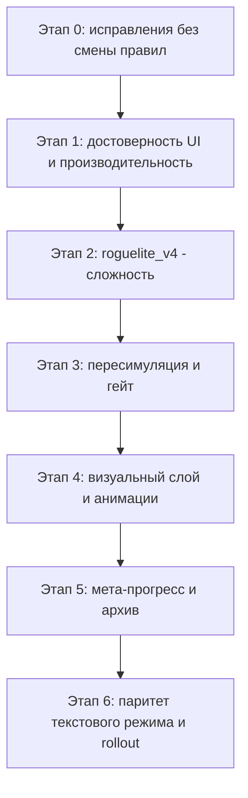

# Смертельная операция: ревью, снижение сложности, визуальный roguelite

Ревью кода по состоянию на 2026-09-22. Источники: `spy_game/death_mission*.py`,
`spy_game/webapp_static/{death.js,game.html,game.css}`,
`spy_game/death_mission_repository.py`, отчёт
`docs/ideas/spy-game-death-mission-balance-v3.json`.

---

## 1. Что сейчас работает хорошо

Архитектура заслуживает отдельного упоминания, потому что все предложения ниже
опираются на неё и её не надо ломать:

- **Версионирование правил.** `Ruleset` неизменяем, открытый забег держит свою
  версию (`state["version"]`), v1/v2 защищены хеш-тестом траекторий. Значит новую
  сложность можно вводить как `roguelite_v4`, не трогая ничего существующего.
- **Единая точка истины для исхода.** `resolve()` используется и runtime, и
  `preview()`, и DP `finale_odds()`, и симулятором. Это очень сильное свойство:
  UI физически не может показать прогноз, расходящийся с реальным броском.
- **Расчёт выплат общий** с settlement (`death_mission_rewards.payout`).
- **Идемпотентность и escrow** сделаны честно: `operation_id` + `request_hash`,
  `reserve`/`settle` ledger, `death_mission_stakes` как неизменяемый снимок
  ставки, outbox для доставки итога.
- **Публичное состояние не течёт**: `public_state()` не отдаёт seed, route и
  неоткрытые offers; есть тест на это.

Проблемы ниже — почти все про игровой дизайн и про подачу, а не про целостность
данных.

---

## 2. Ревью кода: найденные дефекты

Severity: **B** — блокер для rollout, **H** — высокий, **M** — средний, **L** — низкий.

### 2.1 Игровая механика

**[B-1] Риск-пол убивает всю обратную связь «ресурсы → безопасность».**
`_risk()` (`spy_game/death_mission.py:100`) применяет `node_risk_floor` даже к
действиям с `risk_kind="none"` и через `max(floor, ...)` — ко всем остальным.
В `roguelite_v3` floor = `(0, 0, 10, 30, 40)`, `node_damage = (2, 2, 3, 4, 5)`.

Разберём узел 5 (index 4). Доступны только `patrol/archive/contact/ambush`:

| Комната | Действие | Риск | Урон |
|---|---|---:|---:|
| Патруль | Обойти по разведданным (🧠−2) | 40% | 5 |
| Патруль | Проскочить (🚨+1) | 40% | 5 |
| Патруль | Через заграждения (❤️−1) | 40% | 5 |
| Архив | Подменить пропуск (🧠−2, 🧠+2, 🚨+1) | 40% | 5 |
| Архив | Вскрыть терминал (🧠+2) | 40% | 5 |
| Архив | Уйти, пока не заметили (🚨+1) | 40% | 5 |
| Двойной агент | Купить сведения (❤️−1, 🧠+2) | 40% | 5 |
| Двойной агент | Отказаться (🚨+1) | 40% | 5 |
| Засада | Отвлекающий манёвр (🧠−3) | 40% | 5 |
| Засада | Прорываться (🚨+1) | 55% | 5 |
| Засада | Отступить (❤️−2) | 40% | 5 |

**Решения на узле 5 не существует.** Смертельный бросок одинаков во всех
вариантах, отличаются только побочные эффекты. Плата 2–3 разведданными не
снижает риск ни на пункт. При `max_hp = 6` и уроне 5 одно осложнение убивает
группу с ❤️ ≤ 5, то есть почти любую. Узел 5 — это монетка 40/60, а не ход.

То же на узлах 3 и 4 (10%/3 и 30%/4).

Подтверждается отчётом. Политика `careful` (прокси обычного осторожного игрока),
тактика «Баланс», 10 000 забегов:

```
смерти: node3 2, node4 307, node5 1457, finale 1504  (всего 3270)
```

**54% всех смертей происходит в зоне, где у игрока нет выбора**, из них 45% — на
одном узле 5. Это одновременно главный источник сложности и главная потеря
интерактивности.

**[B-2] Документация противоречит коду.** Строка сводки v3
(`spy_game/death_mission_content.py:357`) обещает «Разведданные снижают риск».
В `_risk()` нет ни одного члена, зависящего от `intel`. Разведданные только
разблокируют `cost`-действия, у которых `risk_kind="none"` — а значит на узлах
3–5 они получают `floor` и остаются такими же смертельными. На узлах 1–2 floor
равен 0, поэтому там утверждение верно. Игрок, прочитавший правила, будет
копить 🧠 к финалу и обнаружит, что это ничего не дало.

**[H-3] «Восстановиться» и «пройти мимо» могут убить.** На узле 3 (index 2) пул
комнат полный, поэтому `shelter.heal` (+2 ❤️, `risk_kind="none"`) получает риск
10% и урон 3. Лечебная комната, которая наносит урон, и «Пройти мимо» с
осложнением — это поломанный контракт с игроком; он не может построить
модель мира.

**[H-4] `abandon` выдаёт вечные разблокировки.** `apply()`
(`spy_game/death_mission_repository.py:307`) переводит `abandon` в
`settle(..., "lost")`, а `settle()` (`:418`) начисляет достижения `checkpoint`
и `raid` при `state["node"] >= 3`. UI предлагает «Сдаться» только до
контрольной точки, но HTTP-мутация `abandon` принимается в любой момент. Значит
«Тихий вход» и «Штурм» фармятся так: дойти до узла 3, сдаться, повторить — минуя
узлы 4–5, где и происходит 54% смертей. Экономику это не ломает (ставка теряется),
но обесценивает гейт прогресса.

### 2.2 Достоверность интерфейса

**[H-5] Захардкоженные числа в клиенте расходятся с `Ruleset`.**
- `death.js:23` — «Сеть возвращается удвоенной», хотя `rules.multiplier` настраиваем.
- `death.js:31` `BONUSES` fallback — «Два агента Tier 3», в v3 бонус ×1.
- `death_mission_ui.py:43` `BONUS_LABELS` — то же.
- `death.js:280` — «Эвакуация после узла 3», игнорирует модуль `escape`
  (`escape_checkpoint_node = 2`) и `checkpoint_node`.
- `death.js:426` — подсказка про облаву считает урон `2` и сброс `raid_alarm-2`
  арифметикой на клиенте. `public_state()` вообще **не отдаёт** `raid_damage` и
  `raid_reset`, так что при смене этих чисел в новом `Ruleset` интерфейс будет
  тихо врать.

**[H-6] Строка эффектов действия врёт при «Глушителе».**
`action_text()` (`spy_game/death_mission_ui.py:90`) печатает
`⚠️ осложнение {risk}%: ❤️ −{damage}, 🚨 +1` безусловно. В v2/v3
`silencer_only_complications = True`, то есть с «Глушителем» осложнение тревогу
не поднимает. Ветки `preview` считаются через `resolve()` и корректны — врёт
именно сводная строка, которую игрок читает первой.

**[H-7] Главное число HUD — не то, что игрок думает.** «🎯 Шанс пройти финал»
(`finale_odds`) — это вероятность при условии «войти в финал прямо сейчас с
этими ресурсами». Фактический шанс дожить хуже, потому что узлы 3–5 ещё съедят
❤️. Оговорка есть в подписи, но самое крупное и яркое число на экране
систематически завышает оптимизм и толкает к «продолжить» вместо эвакуации.
Именно на этом решении обычный игрок теряет больше всего: `careful` получает
возврат **0.6725** ставки, а точная DP-политика — до **1.13**.

**[M-8] Путаница 0-based/1-based в нумерации узлов.** В движке `node` считается
с нуля, в текстах — с единицы. `_checkpoint()` — это `node >= 3`, то есть
эвакуация открывается, когда игрок стоит на узле с подписью «Узел 4». Копия
«Эвакуация откроется после узла 3» при этом корректна, но
`updateRoute()` (`death.js:443`) ставит 🪂 на ячейку `index === checkpoint_node`,
то есть на «Узел 4». Заголовок показывает `Узел {min(6, node+1)}/6`, хотя
обычных узлов пять. Нужна одна зафиксированная конвенция и тест на неё.

### 2.3 Надёжность и производительность

**[H-9] `public_state()` слишком дорог для polling раз в 2 секунды.**
`/spy-app/api/game/state` (`spy_game/webapp.py:534`) на каждый опрос выполняет:
для каждого действия — `preview()` (2 × `deepcopy` + `resolve`) и
`_action_odds()` (ещё 2 × `resolve` + `finale_odds`). При ~6 действиях это ~24
`deepcopy` состояния, в котором `log` растёт каждый ход, плюс DP. `_boss_odds` —
`lru_cache(maxsize=200_000)`, живущий всё время процесса и ключуемый 11 полями;
холодные комбинации считаются внутри единственного executor-потока БД
(`database.read`, `spy_game/database.py:98`), то есть соревнуются с остальными
запросами к базе. `pending_results()` (`:487`) строит полный `view()` для до 20
забегов внутри одной транзакции.

**[M-10] `bonus_options`/`bundle` падают на неизвестном типе агента.**
`AGENT_TYPES[agent].tier` (`spy_game/death_mission_rewards.py:21`) и
`AGENT_TYPES[k]` (`death_mission_repository.py:126`). Ставка заморожена в
`death_mission_stakes` при commit; если тип агента когда-нибудь переименуют или
уберут, `view()` начнёт бросать `KeyError` на каждом опросе, а settlement — падать.

**[M-11] `validate()` не проверяет согласованность `phase` с `room`/`offers`.**
Состояние с `phase="action"` и `room=None`, либо `phase="module"` с посторонним
offer, проходит валидацию и падает позже внутри `actions()`
(`KeyError`/`IndexError`). `refresh()` это ловит и возвращает ставку, так что
деньги в безопасности, но путь возврата достигается через исключение, а не через
проверку.

**[M-12] `refresh()` ставит `lost_race` на деактивированное событие.**
`death_mission_repository.py:217`: для `preview`/`armed`, если событие уже не
`active`, но ещё не истекло, статус становится `lost_race` — игрок читает
«Операцию занял другой агент», хотя реальная причина — `/spy_admin disable`
или разрешение события.

**[L-13] Молчаливая потеря нажатий.** `send()` (`death.js:100`) при `locked()`
выходит без обратной связи: нет спиннера и нет состояния на самой нажатой
кнопке. Для квеста это читается как «игра зависла».

**[L-14] Криптографически нечитаемое условие цвета.**
`death.js:477` и `:521`: `event[key] < 0 === (key !== "alarm")`. Работает
(приоритет `<` выше `===`), но выглядит ровно как баг и будет «исправлено»
кем-то в будущем.

**[L-15] Мёртвый CSS-контракт.** `game.html` использует `class="screen active"`,
`death.js` добавляет/снимает `active`, но в `game.css` нет ни одного правила
`.active` — видимость определяется только `.hidden`. Либо убрать, либо описать.

**[L-16] Дрейф документации.** Runbook говорит «версии assets повышены до 4» —
это верно для `game.html` (`game.css?v=4`, `death.js?v=4`), но `index.html`
уже на `styles.css?v=6` / `app.js?v=5`. Формулировку надо привязать к конкретному
файлу.

---

## 3. Снижение сложности

### 3.1 Главное ограничение, о котором нужно договориться

Гейт (`--gate 1.15`) ограничивает ожидаемую выплату **оптимальной** политики.
Фактические цифры v3:

| Политика | Победа | Эвакуация | Возврат ставки |
|---|---:|---:|---:|
| `random` | 9.35% | 0% | **0.187** |
| `careful` | 22.4% | 44.9% | **0.6725** |
| `strong` (точная DP) | 35.6% | 35.6% | до **1.130** |

Сложность здесь не в отдельном броске. Она в том, что **разрыв между обычным и
оптимальным игроком равен 0.46 ставки**, а ставка — вся доступная сеть. Гейт
защищает экономику от идеального игрока, и весь этот разрыв оплачивает обычный.

Отсюда правило для всех изменений: **снижать дисперсию и информационную
асимметрию, а не поднимать EV**. Тогда гейт не трогаем вовсе.

### 3.2 Рычаги, не меняющие EV оптимальной игры

**L1. Частичная ставка (наибольший эффект, ноль работы по балансу).**
Разрешить ставить 25 / 50 / 100% сети (или фиксированный отряд). Гейт — это
*отношение*, он инвариантен к размеру ставки, поэтому пересимуляция не нужна.
Это убирает саму стену «я потерял всё» и даёт игроку обучающий цикл: несколько
дешёвых забегов вместо одного травматичного. Требует: выбор размера в preview,
снимок ставки в `death_mission_stakes` уже это поддерживает (он произвольный
словарь), проверка «не больше доступного» в `arm`/`commit`.

**L2. Убрать риск-пол, вернуть решение на узлах 3–5** (исправление B-1).
Вместо «всё ≥40%» сделать разброс: дорогой тихий проход 10–15%, шумный 35–40%,
болезненный (❤️−2) 20% и т.п. Сложность маршрута сохраняется через накопление
тревоги и расход 🧠, а не через один бросок. Компенсация EV — не в риске, а в
длине: узлов становится больше или тревога растёт быстрее.

**L3. Ограничить урон осложнения сверху так, чтобы один бросок не убивал
с полного здоровья.** Правило: `node_damage[i] <= max_hp - 2`. Для `max_hp = 6`
это максимум 4 вместо 5. Игрок всегда получает как минимум один «второй шанс»,
и решение «эвакуироваться или идти» становится осмысленным, а не лотерейным.

**L4. Показывать правильное число вместо `finale_odds`** (исправление H-7).
DP по всему маршруту уже написана — `death_mission_policy.RoutePolicy`, она
усредняет неизвестные комнаты и модули по распределению предложений. Сейчас она
сознательно не вызывается в HTTP-запросах из-за стоимости. Варианты:
  - **(а)** предрасчёт в таблицу на этапе сборки. Пространство состояний мало:
    ❤️ 0–6 × 🧠 0–6 × 🚨 0–5 × node 0–5 × фаза × набор модулей (≤2 из 6 → 22) ×
    2 объекта × 3 тактики × 3 флага защиты ≈ 3.7 млн ячеек. По одному байту
    (фиксированная точка) — ~4 МБ, это грузится в память или лежит рядом как
    бинарный blob;
  - **(б)** считать лениво с персистентным кешем в SQLite;
  - **(в)** не считать точно, а показывать честный диапазон и прямую
    рекомендацию «сейчас эвакуация выгоднее» / «идти выгоднее» — это и есть то,
    чем `strong` обыгрывает `careful`.
  Любой из вариантов закрывает большую часть разрыва 0.67 → 1.0 **без изменения
  правил**: игрок начинает принимать решение об эвакуации так же хорошо, как DP.

**L5. Обучающий забег.** Один бесплатный «тренировочный» прогон на событие с
нулевой ставкой и нулевой выплатой. Симулятор уже умеет играть без базы и
наград; UI переиспользуется целиком. EV не затрагивается по определению.

### 3.3 Рычаги, требующие пересчёта гейта

Их брать только если L1–L5 окажется недостаточно, и каждый — с прогоном
`death_mission_simulation` и новым `validation-*` набором.

**L6. Пол на проигрыше**: при гибели возвращать 10–25% ставки («часть группы
пробилась к своим»). Психологически это самое сильное изменение и самое
дорогое по EV. Оплачивать придётся чем-то из: множитель ниже ×2 (сейчас
`settings.py:592` требует `>= 2` — нужно менять валидацию), возврат при
эвакуации ⅓ вместо ½, строже порог бонуса.

**L7. Одноразовое «последнее дыхание»** (revive в ❤️1) как разблокируемый
перк. Роглайтно и понятно, но это прямой рост EV.

### 3.4 Принятое решение: L1 + L2 + L3 (+ L4, L5)

Правила упаковываются в новый `roguelite_v4`; v1–v3 остаются нетронутыми.

**Важная поправка по EV.** Рычаги делятся на два класса, и смешивать их нельзя:

| Рычаг | Влияние на EV оптимальной игры | Нужна пересимуляция |
|---|---|---|
| L1 частичная ставка | нет, гейт инвариантен к размеру ставки | **нет** |
| L5 тренировочный забег | нет, нулевая ставка и нулевая выплата | **нет** |
| L4 честный прогноз | нет, DP и так играет оптимально | **нет** |
| **L2 снятие риск-пола** | **растёт** | **да** |
| **L3 урон ≤ max_hp − 2** | **растёт** | **да** |

L2 и L3 напрямую уменьшают вероятность гибели для **всех** политик, включая
точную DP. Отчёт v3 даёт максимальную точную оценку **1.130** при гейте
**1.15** — запас 0.02, то есть его фактически нет. Значит отчёт v3 после L2/L3
перестаёт быть валидной верхней границей, и этап 3 (пересимуляция на
`validation-v4`) становится обязательным условием выхода, а не опцией.

### 3.5 Как снять монетку, не подарив EV

Ключевой принцип: **пол риска превращается в налог на ресурсы с выходом**.
Сейчас на узлах 3–5 все действия стоят 40% независимо от того, как игрок играл
до этого. Вместо этого на каждом позднем узле должен быть набор вида:

- **тихий проход** — дорогой по 🧠 (или по ❤️/🚨), риск низкий (10–15%);
- **шумный проход** — бесплатный, риск высокий (40–50%), плюс тревога;
- **болезненный проход** — гарантированный ❤️−2 без броска.

Тогда игрок, накопивший разведданные, проходит безопасно, а игрок без ресурсов
получает ту же 40%-ю монетку, что и сейчас. Смертность плохой игры сохраняется,
агентность появляется, а рост EV оптимальной политики ограничен тем, что за
безопасность она обязана платить. Это делает 🧠 по-настоящему связанным
ресурсом и заодно закрывает B-2 (обещание «разведданные снижают риск»).

### 3.6 Бюджет компенсации EV

Поскольку запас нулевой, L2/L3 надо оплатить. Кандидаты, отранжированные по
тому, насколько они бьют именно по оптимальной политике, а не по обычному игроку:

1. **Возврат при эвакуации ½ → ⅓.** У `strong` 35.6% забегов заканчиваются
   эвакуацией по 0.5 ставки, это ≈0.178 от её 1.130. Переход к ⅓ снимает
   ≈0.06 — самый крупный и самый точечный источник бюджета, потому что
   эвакуацией оптимальная политика пользуется вдвое активнее обычной
   (35.6% против 44.9% у `careful` — но `careful` при этом чаще эвакуируется
   слишком рано и дешевле).
2. **Удлинить маршрут** (шестой/седьмой обычный узел). Накопительное истощение
   вместо одного смертельного броска: бьёт по всем длинным забегам, то есть по
   победам, и не возвращает лотерею.
3. **Тревога растёт быстрее / порог облавы ниже.** Наказывает именно долгую
   игру и злоупотребление шумными бесплатными действиями.
4. **Строже порог бонуса** (`bonus_min_agents`) либо бонус только за победу без
   эвакуации.
5. **Сузить экономику 🧠** (`max_intel`, `node_cost`), чтобы тихий проход нельзя
   было купить на каждом позднем узле.

**Решено:** основа компенсации — **2 (шестой обычный узел) + 3 (более быстрый
рост тревоги)**. Эвакуация остаётся на ½. Если гейт на `tuning-v4` не проходит,
подключаются 4 и 5 (бонус и экономика 🧠). Категорически не компенсировать
возвратом риск-пола в другом месте — это воспроизведёт исходный дефект под
другим именем.

Шестой узел — не просто число в контенте. Длина маршрута сейчас захардкожена
в нескольких местах и должна стать полем `Ruleset` (`route_length`):

- `Ruleset.node_*` — типы `tuple[int, int, int, int, int]`, нужны кортежи
  произвольной длины с валидацией `len == route_length`;
- `initial()` — `range(5)`;
- `resolve()` — `state["node"] == 5` как вход в финал;
- `validate()` — `len(route) != 5`, `node <= 5`;
- `_boss_odds()` — `node=5`;
- `mission_text()` — `Узел {min(6, node+1)}/6`;
- `death.js` `buildRun()` — шесть ячеек маршрута;
- симулятор — ключи `deaths_by_node` (`node3`…`node5`, `finale1`…).

Хеш-тест v1/v2 обязан остаться зелёным: для них `route_length = 5`.

### 3.7 Частичная ставка: границы реализации

- Размеры 25 / 50 / 100% считать по типам агентов с округлением вниз, но с
  гарантией «не ноль, если доступен хотя бы один агент», иначе мелкая сеть
  получит пустую ставку.
- Снимок ставки в `death_mission_stakes` — уже произвольный словарь, схема
  менять не нужно.
- Проверять размер **дважды**: в `arm` и повторно в `commit` перед
  резервированием, там же где сейчас живёт `STALE_STAKE`.
- Бонусный порог (`bonus_min_agents = 5`) считается **по фактической ставке**,
  а не по сети. При ставке 25% бонусы будут закрываться чаще — это корректно и
  это надо явно показать в preview, иначе игрок решит, что интерфейс сломан.
- `extraction` в payload должен пересчитываться от выбранного размера.

---

## 4. Интерактивность и визуальное прохождение

Текущий HTML5-экран — это сильный, но статичный дашборд: HUD-сегменты, полоска
маршрута из 6 ячеек, полоса шанса, карточки действий с двумя ветками, журнал.
Ничего не *происходит*: результат броска появляется мгновенно, единственная
анимация — дельта-чип на 1.8 с.

### 4.1 Сделать бросок событием, а не подменой числа

1. **Фаза раскрытия исхода.** После нажатия: показать шкалу риска, «прокрутить»
   значение, зафиксировать успех/осложнение, и только потом применить дельты к
   HUD с задержкой. Сервер уже возвращает событие со всеми полями
   (`failed`, `risk`, `hp/intel/alarm`, `absorbed`, `medic`, `raid`, `passport`) —
   клиенту нужен только конечный автомат анимации, новых данных не требуется.
2. **Экран облавы.** `raid` сейчас — просто чип в журнале. Это должен быть
   отдельный кадр: сирена, урон, сброс тревоги.
3. **Срабатывание защиты.** `absorbed`, `medic`, `passport` — отдельные короткие
   всплески на соответствующем элементе HUD, а не текст в списке.

### 4.2 Сделать маршрут картой

4. **Показывать типы комнат на один узел вперёд.** Сейчас `route` полностью
   скрыт, видны только 2 комнаты текущего узла — планировать нечем. Открыть
   следующий слой (и оставить дальнейшие закрытыми) — это классическая
   roguelite-карта и мгновенный прирост осмысленности решений. Требует
   аккуратного расширения `public_state()`: отдавать `route[node + 1]`, не
   отдавая остальное.
5. **Ветвящаяся карта вместо полоски.** Два пути, иконка типа комнаты, метки
   ◆ (модуль) и 🪂 (эвакуация) на правильных узлах (см. M-8), финал — отдельный
   блок из трёх фаз с именами.
6. **Трек финала.** Три фазы объекта как визуальный прогресс с названиями
   (`phase_names` уже приходит), а не строка «Фаза 2 из 3».

### 4.3 Атмосфера и понятность

7. **Иконография комнат и объектов.** Шесть комнат, два финальных объекта —
   немного ассетов, большой эффект на читаемость.
8. **Нарратив на исход.** В проекте уже есть `spy_game/narrator.py`. Одна живая
   строка на исход действия вместо `label — осложнение: ❤️ −4` превращает журнал
   в текст квеста.
9. **Тревога как «жар».** Визуальное нагнетание фона/рамки при 🚨 4–5 с явным
   обратным счётом до облавы.
10. **Разбор забега.** Финальный экран — таймлайн решений: узел, выбор, риск,
    что выпало, и точка, где забег был проигран. Данные уже есть в `state["log"]`
    целиком. Это главный обучающий инструмент и он же снижает сложность
    следующего забега.

### 4.4 Roguelite-мета

11. **Архив вместо двух флагов.** Сейчас вся мета — `checkpoint >= 3` →
    «Тихий вход» и `raid` → «Штурм», модули между забегами не сохраняются.
    Для «понятного roguelite» нужен видимый экран прогресса: что открыто, что
    следующее, сколько до него. Кандидаты на разблокировку: новые модули в пул
    предложений, третий слот модуля, +1 стартовое 🧠, «последнее дыхание» (L7).
12. **Гейт считать по полностью открытому билду.** Как только мета начинает
    давать силу, экономический гейт должен проверяться именно на максимально
    прокачанном варианте, а не на «Балансе».
13. **Паритет текстового режима.** Telegram-fallback должен остаться играбельным
    квестом: компактный HUD (`❤️▮▮▮▮▯▯`), строка маршрута, ветки действий. Сейчас
    там нет ни карты, ни трека финала.

---

## 5. Порядок работ



**Этап 0 — безопасные исправления, ничего не меняют в балансе:** H-4, M-10,
M-11, M-12, L-13, L-14, L-15, L-16.

**Этап 1 — интерфейс перестаёт врать:** H-5, H-6, M-8, H-9. Сюда же вынос
`raid_damage`/`raid_reset`/`checkpoint_node` в `public_state()` и кеш
payload по `(run_id, revision)`.

**Этап 2 — новый `roguelite_v4`:** B-1, B-2, H-3, L1, L2, L3, L5 по схеме
из 3.5–3.7. v1–v3 не трогаем, хеш-тест траекторий должен остаться зелёным.
Частичная ставка (L1) реализуется отдельно от `Ruleset` — это механика ставки,
а не правил забега, и она должна работать и на v3.

**Этап 3 — гейт, обязательный:** новый `tuning-v4` и `validation-v4-*`, прогон
10 000 забегов на комбинацию, подбор компенсации из 3.6 до выполнения условия
≤1.15, обновление отчёта и runbook. Без пройденного гейта этап 2 не выпускается.
Отдельно проверить, что `all_stakes_bound` и точная DP-оценка по каждому объекту
финала тоже укладываются в гейт.

**Этап 4 — визуал:** пункты 1–10. Требует обновления `game.css`, `death.js`,
`game.html` вместе с поднятием `?v=`, плюс `tests/test_death_mission_ui.js` и
`tests/test_death_mission_browser.js`.

**Этап 5 — мета:** пункты 11–12 плюс L4 (правильный прогноз), новая миграция для
архива прогресса.

**Этап 6:** пункт 13, ручная проверка в Telegram двумя аккаунтами по чек-листу
runbook, beta-чат, rollout.

---

## 6. Решено

- **Частичная ставка (L1)** — да, 25 / 50 / 100%. EV-нейтрально, гейт не трогаем.
- **Снятие риск-пола (L2) и урон ≤ max_hp − 2 (L3)** — да, в `roguelite_v4`,
  по схеме «налог на ресурсы с выходом» из 3.5, с компенсацией из 3.6.
- **Гейт 1.15 остаётся** и `death_operation_reward_multiplier >= 2` не снимаем.
  Значит L6 (пол на проигрыше) и L7 (revive) **из области работ исключены**.
- **Пересимуляция обязательна** — отчёт v3 после L2/L3 недействителен.

- **Компенсация EV** — шестой обычный узел + более быстрый рост тревоги.
  Эвакуация остаётся на ½. Бонус и экономика 🧠 — только если гейт не пройдёт.

## 7. Открытые вопросы

1. **Срок миссии.** Шестой узел удлиняет забег; 15 минут (`SPY_GAME_DEATH_MISSION_SECONDS`)
   могут стать тесными для текстового режима. Поднимать до 20?
2. **Порог облавы при более быстрой тревоге.** Растим `risk_per_alarm`, режем
   `raid_alarm`, или добавляем +1 🚨 к шумным действиям на поздних узлах?
   Все три по-разному бьют по «Штурму».
3. **Прогноз по всему маршруту (L4)** — предрасчитанная таблица (~4 МБ),
   ленивый кеш в SQLite, или только текстовая рекомендация без точного числа?
4. **Карта на узел вперёд (п. 4)** — открывать? Это меняет информационную модель
   и требует пересчёта DP-политики, которая сейчас усредняет неизвестные комнаты.
5. **Мета-прогресс (этап 5)** — делаем в этой итерации или откладываем? Он
   добавляет силы игроку, значит гейт придётся считать по полностью открытому
   билду, а не по «Балансу».
